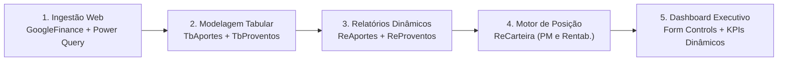

# Sistema de Gestão de Carteira de Ativos & Dashboard Executivo no Excel

---

## Resumo Executivo:

A gestão de patrimônio e investimentos individuais frequentemente sofre com a fragmentação de dados em múltiplas corretoras, planilhas estáticas desatualizadas e falta de clareza sobre o retorno real da carteira (ganho de capital versus fluxo de proventos e dividendos). Neste projeto desenvolvido em **Microsoft Excel Avançado**, construí um ecossistema completo de gestão de ativos: integrei cotações automáticas da B3 via **Google Sheets (`GOOGLEFINANCE`) e Power Query**, estruturei bancos de dados relacionais de aportes e proventos, e desenvolvi um **Dashboard Executivo Interativo** com controle de formulário (*Caixa de Combinação*) para alternar dinamicamente entre visões de **Ações**, **Fundos Imobiliários (FIIs)** e visão consolidada da carteira.

A partir da consolidação de **28 aportes** (totalizando **R$ 26.791,03**) e do acompanhamento de **R$ 6.793,12** em proventos líquidos recebidos, diagnostiquei a performance global da carteira (valor de mercado atual de **R$ 40.317,94** + **R$ 20.000,00** em caixa = **R$ 60.317,94** em patrimônio global, gerando uma valorização de capital de **+50,49%** e um retorno total combinado de **+75,85%**).

Com base nas análises de concentração e rentabilidade, elaborei recomendações estratégicas para o investidor:

1. **Rebalanceamento por Aportes e Desconcentração de Risco:** Reduzir a alta exposição à PETR4 (que atingiu **52,3%** do valor investido da carteira) direcionando novos aportes e parte do caixa para ativos defensivos e FIIs com desconto.
2. **Estratégia DRIP (*Dividend Reinvestment Plan*):** Reinvestir sistematicamente o fluxo mensal de proventos (que somou R$ 6.793,12 no período, com 71,3% oriundo de FIIs isentos de IR) para acelerar a curva de juros compostos da carteira.
3. **Alocação Estratégica da Reserva de Caixa:** Aproveitar a reserva disponível de R$ 20.000,00 (33,2% do patrimônio total) para aportes táticos em ativos com maior margem de segurança.
4. **Auditoria de Eventos Acionários e Gestão de Posições Críticas:** Revisar o histórico de desdobramentos/grupamentos em HGBS11 e avaliar a continuidade da tese de investimento em CSNA3 (-58,6% de desvalorização).

---

### Problemas de Negócio:

Investidores de ações e fundos imobiliários enfrentam desafios operacionais diários para apurar com precisão a saúde financeira de sua carteira:

* **Cálculo de Preço Médio (PM):** A realização de múltiplos aportes ao longo do tempo em diferentes preços unitários e com incidência de taxas de corretagem torna o cálculo manual do PM suscetível a erros, prejudicando a apuração de rentabilidade e de Imposto de Renda.
* **Desconexão entre Renda Passiva e Valorização:** Dificuldade em visualizar separadamente o quanto o patrimônio cresceu por **ganho de capital** (variação das cotações) versus o quanto foi gerado por **dividendos e rendimentos isentos**.
* **Falta de Atualização Automatizada:** Dependência de digitação manual de cotações de fechamento, gerando dados defasados.
* **Visão Agregada x Segmentada:** Necessidade de alternar rapidamente a análise entre a carteira global, apenas a classe de Ações ou apenas Fundos Imobiliários em uma única interface intuitiva.

O objetivo do projeto foi responder a estas perguntas de negócio:
1. *Qual é o valor atualizado, o custo total aportado e o lucro/prejuízo nominal e percentual de cada ativo da carteira?*
2. *Como está distribuído o patrimônio entre Ações, Fundos Imobiliários e Reserva de Caixa?*
3. *Quais são as maiores posições e os ativos de maior/menor performance relativa no portfólio?*
4. *Qual é o volume e a evolução mensal do fluxo de proventos recebidos por classe de ativo?*

---

### Demonstração do Dashboard:


---

### Metodologia:

O projeto foi executado seguindo um pipeline estruturado de dados em 5 fases:



1. **Ingestão Automatizada de Cotações em Tempo Real:**
   * Criação de planilha integrada no **Google Sheets** utilizando a função `=GOOGLEFINANCE(ticker; "price")` para os ativos de interesse da B3 (`PETR4`, `ITSA4`, `TAEE4`, `FLRY3`, `CSNA3`, `HGLG11`, `KNRI11`, `HGRE11`, `HGBS11`).
   * Publicação da planilha na web em formato `.csv` e consumo automatizado no Excel via **Power Query (Obter Dados -> Da Web)** na tabela estruturada `TbAtivos`.

2. **Modelagem de Dados e Cadastro Estruturado:**
   * **`TbAportes`:** Registro transacional de 28 compras contendo Data, Ativo, Quantidade, Preço Unitário, Custos Operacionais e colunas calculadas de valor total (`Qte * Unitário + Custos`), Tipo (`EMPRESA` / `FII`) e atributos temporais (`Ano`, `Mês`, `Ano/Mês`).
   * **`TbProventos`:** Histórico de dividendos e rendimentos com apuração de Valor Bruto, Imposto de Renda retido na fonte e Valor Líquido recebido.

3. **Geração de Relatórios Dinâmicos de Fluxo de Caixa (Pivot Tables):**
   * **`ReAportes`:** Tabela dinâmica matricial com evolução mensal dos aportes discriminados por classe de ativo e papel individual.
   * **`ReProventos`:** Tabela dinâmica de proventos mensais recebidos, evidenciando a consistência e previsibilidade da renda passiva.

4. **Motor de Cálculo de Posição Acionária (`ReCarteira`):**
   * Consolidação de métricas por ativo através de fórmulas avançadas:
     * **Total Aportado:** `=SOMASE(TbAportes[Ativo]; Ativo; TbAportes[Total])`
     * **Quantidade Total:** `=SOMASE(TbAportes[Ativo]; Ativo; TbAportes[Qte])`
     * **Preço Médio (PM):** `=Total Aportado / Total Quantidade`
     * **Cotação Atual:** Busca dinâmica via `=PROCV(Ativo; TbAtivos[#Tudo]; 3; FALSO)`
     * **Valor de Mercado:** `=Total Quantidade * Cotação`
     * **Valorização Nominal e %:** `=Total Atual - Total Aportado` e `=(Total Atual - Total Aportado) / Total Aportado`
   * **Parâmetro Temporal Dinâmico:** Célula trancada com data de corte (`Até qual data?`) com fórmula de fallback para data atual: `=SE(L1="";HOJE();L1)`.
   * **Segmentação em Sub-planilhas:** Estruturação das abas `ReCarteiraAções` e `ReCarteiraFII` para filtragem específica.

5. **Construção do Dashboard Executivo Interativo (`Dashboard` & `DashboardAux`):**
   * Inserção de controle de formulário **Caixa de Combinação (Combo Box)** vinculado a uma tabela auxiliar (`DashboardAux`), permitindo chavear a visão entre `1 - Tudo`, `2 - Ações` e `3 - Fundos Imobiliários`.
   * Caixa de entrada de valor para Reserva de Caixa (*Cash*).
   * **Cards de KPIs Dinâmicos:** Total Aportado, Valor da Carteira, Valorização R$ e Valorização % conectados dinamicamente à opção selecionada.
   * **Visualizações Gráficas:**
     * *Gráfico de Rosca:* Composição do patrimônio global entre Ações, FIIs e Caixa.
     * *Gráficos de Barras Horizontais Dinâmicos:* Rankings ordenados dos ativos com maiores posições financeiras e maiores valorizações percentuais, desenvolvidos com as funções `MAIOR` (LARGE), `ÍNDICE` (INDEX), `CORRESP` (MATCH) e tratamento de erros (`ÉNÚM` e `É.NÃO.DISP`).

---

### Habilidades & Tecnologias Utilizadas:

* **Microsoft Excel Avançado:** Fórmulas lógicas, de busca e matriciais (`ÍNDICE`, `CORRESP`, `MAIOR`, `SOMASE`, `PROCV`, `SE`, `ÉNÚM`, `É.NÃO.DISP`, `HOJE`).
* **Modelagem e Estruturação de Dados:** Criação de Tabelas Estruturadas (`TbAtivos`, `TbAportes`, `TbProventos`), padronização de chaves e campos auxiliares.
* **ETL & Conectores Web (Power Query):** Extração de dados da web via link CSV do Google Sheets e atualização dinâmica de cotações de mercado.
* **Google Sheets & Funções Financeiras:** Configuração de planilha na nuvem com `=GOOGLEFINANCE` para alimentação contínua de cotações da B3.
* **Tabelas Dinâmicas (Pivot Tables):** Agrupamento temporal de aportes e proventos, segmentação por classe e consolidação matricial.
* **Design de Dashboards & UX no Excel:** Controles de formulário (*Combo Box*), cartões de KPI, formatação condicional (destaque de rentabilidades negativas em vermelho) e visualizações analíticas (rosca e barras ordenadas).

---

### Resultados & Recomendações Estratégicas:

A consolidação do modelo no Excel forneceu clareza instantânea sobre a evolução patrimonial e o comportamento dos ativos:

#### 📌 Panorama Global da Carteira:
* **Capital Total Aportado:** **R$ 26.791,03** distribuído em 28 operações ao longo de 1 ano.
* **Valor de Mercado dos Ativos:** **R$ 40.317,94** (**+R$ 13.526,91** ou **+50,49%** de valorização de capital).
* **Reserva de Caixa Alocada:** **R$ 20.000,00** (totalizando **R$ 60.317,94** em patrimônio global).
* **Proventos Totais Recebidos:** **R$ 6.793,12** líquidos (**R$ 6.802,49** brutos).
* **Retorno Total Combinado (*Total Return*):** **R$ 20.320,03** (**+75,85%** de retorno real sobre o capital aportado somando ganho de capital e dividendos líquidos).

#### 📊 Performance por Classe de Ativo:

| Classe de Ativo | Total Aportado (R$) | Valor Atual (R$) | Valorização (R$) | Rentabilidade (%) | Proventos Líquidos (R$) | Retorno Total (R$) | Retorno Total (%) |
|---|:---:|:---:|:---:|:---:|:---:|:---:|:---:|
| 📈 **Ações (Empresas)** | R$ 17.598,00 | R$ 32.737,00 | +R$ 15.139,00 | **+86,03%** | R$ 1.946,99 | +R$ 17.085,99 | **+97,09%** |
| 🏢 **FIIs (Imobiliários)** | R$ 9.193,03 | R$ 7.580,94 | -R$ 1.612,09 | **-17,54%** | R$ 4.846,13 | +R$ 3.234,04 | **+35,18%** |
| **Total Investido** | **R$ 26.791,03** | **R$ 40.317,94** | **+R$ 13.526,91** | **+50,49%** | **R$ 6.793,12** | **+R$ 20.320,03** | **+75,85%** |

#### 🔍 Diagnóstico dos Ativos Individuais:
* **PETR4 (Petrobras):** Principal propulsor de ganhos da carteira. Aportes de R$ 6.614,00 valorizaram para R$ 21.084,00 (**+218,8%** de ganho de capital), além de dividendos expressivos. Contudo, passou a representar **52,3% do valor da carteira investida**, gerando alta concentração de risco em uma estatal de commodities.
* **TAEE4 & ITSA4:** Excelente desempenho defensivo, com valorizações de **+62,7%** e **+48,7%** respectivamente, garantindo estabilidade e bom fluxo de dividendos.
* **FIIs como Geradores de Renda Passiva:** Embora os FIIs tenham registrado recuo nominal de cotação (-17,5%), geraram **R$ 4.846,13** em proventos líquidos isentos de IR (rendimento de **52,7%** sobre o custo de aquisição), compensando com folga a oscilação de cotações e fechando com retorno positivo global de **+35,18%**.

#### 💡 Recomendações Estratégicas para o Investidor:

1. **Rebalanceamento por Aportes (Mitigação do Risco PETR4):**
   * Evitar a venda imediata para não antecipar pagamento de IR, mas pausar aportes em PETR4 e utilizar os novos recursos mensais e a reserva de caixa para comprar outros ativos da carteira até reduzir a exposição de PETR4 para uma faixa máxima prudencial de 20% a 25%.
2. **Reinvestimento Automático de Dividendos (DRIP):**
   * O fluxo de proventos acumulado de R$ 6.793,12 não deve permanecer inerte. Recomenda-se a alocação imediata dos dividendos recebidos na compra de novas cotas de FIIs de tijolo/logística (como `HGLG11` e `KNRI11`), gerando um ciclo acelerado de geração de renda.
3. **Gestão Tática da Reserva de Caixa (R$ 20.000,00):**
   * A reserva em caixa de 33,2% confere alto poder de compra para momentos de correção de mercado. Recomenda-se manter parte dessa quantia em instrumentos de renda fixa com liquidez diária (100% do CDI) e programar compras fracionadas nos ativos descontados.
4. **Auditoria de Eventos Acionários:**
   * Investigar o recuo de -90,5% na cotação de `HGBS11` (frequente indicador de desdobramento de cotas que exige atualização da quantidade custodiada no banco de dados para correção do Preço Médio e do valor patrimonial).

---

### Estrutura de Arquivos do Projeto:

```text
seção 17 - projeto ativos/
├── 📄 README.md                        # Documentação executiva completa do projeto
├── 📊 projeto-ativos.xlsx              # Pasta de trabalho principal com Tabelas, Relatórios e Dashboard
├── 📑 base-de-dados-projeto-ativos.xlsx # Base de dados histórica bruta (Aportes e Proventos)
├── 📑 projeto-gestao-de-ativos.pdf     # Documento com diretrizes pedagógicas e requisitos do projeto
└── 🖼️ Demonstração do Dashboard.png   # Imagem de demonstração do Dashboard Executivo
```

---

### Próximos Passos:

1. **Módulo de Realizações e Apuração de Imposto de Renda (IR):**
   * Desenvolver planilha e relatórios de vendas de ativos com cálculo automático de lucro tributável, verificação da faixa de isenção de R$ 20.000,00/mês para ações e geração de valores para emissão de DARF (15% para ações e 20% para FIIs).
2. **Migração do Modelo para Power BI:**
   * Construir modelo relacional no Power BI com Star Schema e medidas DAX avançadas (`XIRR`, *Time Intelligence*, rentabilidade ponderada pelo tempo - TWR), possibilitando visualizações com filtros cruzados de datas e setores.
3. **Automação via Python / API Financeira:**
   * Desenvolver script com `yfinance` ou API da B3 para atualização automática em segundo plano, sem necessidade de publicação manual pelo Google Sheets.

---

### Autor

Projeto desenvolvido por **Giovany César** no âmbito do curso **Excel Completo do Básico ao Avançado** dos professores Dr. Nélio Alves e Me. Bruno Arantes.
